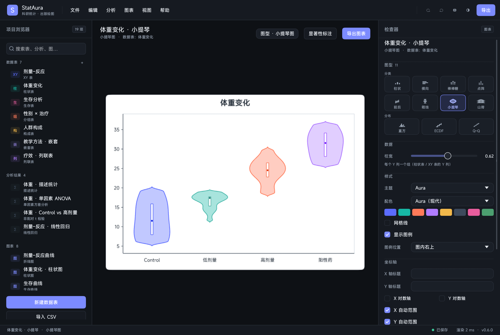

# StatAura 设计规范

> 设计目标：**安静的界面，让图成为主角。** 工具应该像实验室里一张干净的操作台，而不是一堆控件。

---

## 1. 气质

- **Aura**：数据周围的“光晕”。强调色取偏冷的靛蓝（#5B6CFF），配合青绿与珊瑚作为第二、第三数据色；
- 背景是带一点冷调的纸白（#F4F6F8），面板纯白，边界用 1px、低对比的冷灰；
- 不使用大面积渐变、玻璃拟态或重阴影；阴影只用于浮层，强度控制在“能分层但不抢戏”；
- 图表画布**恒为白底**，即使在深色模式（出版规范）。


---

## 2. 设计令牌

### 2.1 颜色（浅色）

| 令牌 | 值 | 用途 |
|---|---|---|
| `bg` | `#F4F6F8` | 应用底色 |
| `panel` | `#FFFFFF` | 卡片、顶栏、检查器 |
| `panel_alt` | `#FAFBFC` | 输入框、次按钮、表头 |
| `sidebar` | `#FAFBFC` | 左侧导航 |
| `border` | `#E2E6EC` | 面板 / 控件边界 |
| `border_soft` | `#EDF0F4` | 网格线、分隔 |
| `ink` | `#1B2430` | 主文字 |
| `muted` | `#5D6979` | 次级文字 |
| `faint` | `#798492` | 说明、刻度（仅补充信息） |
| `accent` | `#5B6CFF` | 主操作、选中 |
| `accent_soft` | `#EEF0FF` | 选中底 |
| `accent_ink` | `#3A49E0` | 选中文字 |
| `success` | `#18A47A` | 已保存、成功 |
| `danger` | `#E5484D` | 删除、未保存 |

### 2.2 颜色（深色）

| 令牌 | 值 |
|---|---|
| `bg` | `#0E1115` |
| `panel` | `#161A21` |
| `panel_alt` | `#1A1F27` |
| `sidebar` | `#12161B` |
| `border` | `#282E38` |
| `ink` | `#E9EDF2` |
| `muted` | `#939EAC` |
| `faint` | `#8C97A6` |
| `accent` | `#7C8BFF` |
| `accent_soft` | `#242A44` |

深色模式下，图表、结果表卡片仍然白底；只有应用外壳变暗。
原因：科研图最终要打印/投稿，编辑器的深色不应污染对图底色的判断。

### 2.3 字体与字号

界面字号收敛成 6 级（`theme::text`），相邻级差约 2px，避免出现 11.5 / 11.8 / 12.2 这种“差一点点”的层级。

| 角色 | 令牌 | 字体 | 字号 |
|---|---|---|---|
| 页面标题（画布 / 结果） | `DISPLAY` | MiSans | 15.5 |
| 对象标题（检查器 / 侧栏行） | `TITLE` | MiSans | 14 |
| 正文、按钮、控件文字 | `BODY` | MiSans | 12 |
| 表单标签 | `LABEL` | MiSans | 10.5 |
| 元信息（类型、来源） | `META` | MiSans | 9.8 |
| 微标签（徽标、磁贴说明） | `MICRO` | MiSans | 9 |
| 数据格 | — | MiSans | 11.8 |
| 图表标题 | — | MiSans / Times | 13.5 pt |
| 图表刻度 | — | MiSans / Times | 8.4 pt |
| 图表轴标题 | — | MiSans / Times | 9.8 pt |

图表字体随主题切换：Aura/Prism/Mono → MiSans；Nature → Times New Roman。

### 2.4 间距

全部从 `theme::metric` 取，不再在业务代码里写魔法数字。

| 令牌 | 值 | 用途 |
|---|---|---|
| `PAD_X` / `PAD_Y` | 16 / 14 | 侧栏、检查器内容区的水平 / 垂直留白 |
| `CONTENT_PAD` | 20 | 中央工作区（数据表 / 画布 / 结果）的水平留白 |
| `BAR_PAD_X` | 18 | 顶栏、状态栏两端留白 |
| `LABEL_W` | 58 | 表单标签列宽 |
| `GAP_X` | 10 | 标签列与控件列之间 |
| `ROW_H` / `ROW_GAP` | 28 / 6 | 表单行高与行距 |
| `CONTROL_H` | 26 | 输入框、下拉框、分段控件高度 |
| `SECTION_GAP` / `SECTION_LEAD` | 16 / 8 | 章节上间距 / 章节标题到内容 |
| 顶栏 / 状态栏 | 52 / 26 | |
| 侧栏 / 检查器 | 236 / 312 | |

### 2.5 版式网格（光学对齐）

每个片区只允许存在**两条竖线**：

1. 内容左边界 = 面板左边 + `PAD_X`（中央区域 + `CONTENT_PAD`）；
2. 控件左边界 = 内容左边界 + `LABEL_W` + `GAP_X`，控件右边缘与内容右边界重合。

由此得到的排布规则：

- 表单标签**左对齐**到内容左边界，与章节标题、复选框方框共用同一条线；
- 下拉框、输入框、滑杆、分段控件等宽（= 内容宽 − 标签列），右边缘齐平；
- 滑杆的数值单独右对齐到控件列右边界，位数不同也不会参差；
- 复选框整行从内容左边界起排，方框 15×15、文字距方框 9；
- 章节标题上方一条发丝线，标题与线间距 5，标题到内容 8；
- 滚动条改为右槽里 3px 宽的指示条（`AlwaysHidden` + 自绘），**不占用内容宽度**，
  否则控件右边缘会比标题右边缘少 7–8px；
- 顶栏、状态栏两端的簇按测量结果顺排，不使用固定 x 偏移。

实现集中在 `app/form.rs`（`Form` 表单网格 / `scroll_body` / `panel_header`），
任何新的设置项都应通过 `Form` 添加，而不是手写 `ui.label` + `ui.add`。

### 2.6 圆角阶梯

圆角随元素尺寸递增，嵌套时用 `radius::nested(outer, inset)` 保持同心：

| 令牌 | 值 | 用途 |
|---|---|---|
| `CHIP` | 5 | 徽标、色块、复选框、滚动指示条 |
| `CONTROL` | 8 | 按钮、输入框、下拉框、滑杆手柄底 |
| `nested(CARD, 2)` | 10 | 侧栏行、图型磁贴（嵌在 12 圆角容器内） |
| `CARD` | 12 | 数据网格卡片、结果卡片、图表画布 |
| `PANEL` | 16 | 空状态大卡片 |
| `WINDOW` | 20 | 窗口、命令面板 |

所有自绘表面走 `widgets::surface()`，其路径由**超椭圆**（指数 0.72）采样而来，
而不是正圆圆弧：45° 处的点落在“正圆之外、外接方形之内”，曲率变化连续，
大圆角（卡片 / 窗口）观感更顺，小圆角几乎与正圆无差别。
位图与自绘网格只能用方角绘制，用 `widgets::punch_corners()` 把四角“啃”回圆角后
再补描边，保证与其它卡片的圆角一致。

分割线 1px；表格网格线 1px 但用 `border_soft`，只做定位不做装饰。

---

## 3. 图标

- 统一 24×24 画布、1.5px 线宽、圆角端点；缩放到 16–20px 仍可辨认；
- **全部自绘**：不依赖字体是否含 `↶ ◐ ⌘ ▤` 等符号（MiSans 缺这些字形，会显示方框）；
- 图表类型图标用“图形本身”表意（散点是 4 个点，柱状是 3 根柱，箱线是箱+须）；
- 图标颜色跟随文字层级：默认 `muted`，hover `ink`，选中 `accent`。

---

## 4. 组件

### 顶栏

左：品牌标 + 名称 + 副标题；中：文件/编辑/分析/图表/视图/帮助；右：命令面板、主题、撤销/重做、导出。
高度 54，底部 1px 边框。导出是唯一实心主按钮。

### 侧栏

236 宽，“项目浏览器”：面板头（标题 + 计数）+ 搜索框 + 三个分组。
行高 34，两行信息：主标题（12.2）+ 类型（9）；左侧 24×18 徽标（XY/柱/组/列/生/构/变/Σ/图）。
两行文字按行中心对称分布（上移 6 / 下移 7），视觉重心才落在行中心。
选中：`accent_soft` 底 + 左侧 3px 竖条（两者同心圆角）；hover：中性灰底。
分组标题右侧的“＋”只在能新增内容的“数据表”分组出现，避免点了没反应的按钮。

### 数据网格

- 行高 24、列宽 96（可横向滚动）、行头 56；
- 表头分两级：组名 + 子列名；无子列时自动收成 40 高的一级表头；
- 数字右对齐、文本左对齐；排除值用强调色 + 删除线；
- 当前单元格 1.6px 强调色描边，选区 8% 强调色填充；
- 行头显示序号或行标题；选中行/列时行头轻微着色。

### 检查器

固定 312 宽。面板头 46 高：“检查器”（12、`muted`）+ 右侧上下文标签；
其下是对象标题（14、`ink`）+ 一行元信息，形成三级层级。

内容按 §2.5 的两列网格排布：标签左对齐、控件等宽右齐。
分组用“发丝线 + 小号标签”（图型 / 数据 / 样式 / 坐标轴 / 显著性标注），
章节之间 16 间距。图表类型用 3 列等宽磁贴（每行 3 个，末行不足时左对齐），
磁贴内图标 28×18、短名 9px。

### 结果页

白色卡片按内容自适应高度（不留大片空白）。表头 26、行高 24；
**列的对齐方式按数据类型推断**：全数字列右对齐（表头也右对齐），文本列左对齐，
于是“表头右边缘”与“数值右边缘”落在同一条线上。方法说明在表格上方，注释在下方。
不做斑马纹；用留白和字号建立层级。

### 浮层

导出对话框居中、内容宽 484（窗口宽 520），同样是“标签列 + 控件列”网格：
格式 4 等分按钮、分辨率 4 段分段控件、文件行（按钮先排右侧再让输入框吃掉剩余宽度）。
窗口投影 `offset 10 / blur 28 / alpha 34`，命令面板更轻。
命令面板：搜索框 + 行（命令名 / 说明 / 快捷键三列，说明列宽取最长命令名）+ 底部快捷键提示。
Toast 右下角堆叠，成功绿底白字、错误红底白字，3.2 秒自动消失。



---

## 5. 图型体系

24 种图型收敛到 **4 个坐标映射族**，绘制代码按族分派，而不是按 24 个变体分派。
新增图型只要落进已有族，就不需要写新的绘制核心。

| 族 | 图型 | 核心 | 数据前提 |
|---|---|---|---|
| XY 坐标 | 散点、折线、平滑曲线、阶梯线、面积图、回归图 | `render_xy` | XY 表（一列 X + 若干列 Y）|
| 分类 | 柱状、分组柱、堆叠柱、百分比堆叠、横向柱、棒棒糖、点阵、前后对比、箱线、小提琴、山脊 | `render_categorical` / `render_grouped` / `kinds::*` | 每列一组，或分组表（行 = 类别，列 = 系列）|
| 分布 | 直方图、ECDF、Q–Q | `extras::render_distribution` | 数值列 |
| 其他 | 生存曲线、热图、饼图、环形图 | `extras::*` / `kinds::render_pie` | 生存表 / 分组表 / 构成表 |

### 5.1 三条硬规矩

1. **先定定义域，再做映射。** 与 plotters 的 `Ranged` + `map_coord` 一个思路：
   Y 轴范围由「真正会画出来的几何」决定——小提琴按核密度支撑、回归带把端点置信区间、
   堆叠柱按堆叠总量、点阵按分箱后的最高点。
2. **进场景前一律裁剪。** `plot/clip.rs` 提供 Sutherland–Hodgman 多边形裁剪与
   Liang–Barsky 线段裁剪；线、面积、置信带、小提琴尾巴都走它。用户手动设了范围也照样成立。
3. **数据不满足前提就说清楚。** 每种图型都有 `ChartKind::requires()` 一句话说明，
   渲染层直接把它画在画布中央，例如「前后对比图至少需要两列（前 / 后）」。
   绝不画一张看起来像图、其实语义错的东西。

### 5.2 小提琴：为什么以前会越出 Y 轴

核密度在数据极值之外仍有尾巴。前后试过两种都不对的做法：按 `min/max` 定轴再外扩
（尖端跑出坐标框），以及按 `2.5×带宽` 外推并把外推范围并进坐标轴（尖端落到 0 刻度
以下，看起来还是「超出 Y 轴」，而且暗示数据范围之外还有观测）。

**最终口径 = ggplot2 `geom_violin(trim = TRUE)`（默认）/ seaborn `cut = 0`：**

- 网格严格铺在 `[min, max]` 上，**一个像素都不外推**；
- 两端各 8% 区间用升余弦窗把密度平滑压到 0，轮廓自然收成尖；
- Y 轴只按数据范围定（`Axis::from_values` 自带 6% padding），因此轮廓**结构上
  不可能越出坐标框**，也不需要为看不见的尾巴撑高轴；
- 带宽退化（σ = IQR = 0）时回退到数据量级的 1e-3，避免无限尖峰；
- 平头/尖头是 `trim = TRUE` 的标准表现，不是被切掉。

组内还嵌了四分位条与中位数点（Prism 的默认标记）。
`chart::tests` 里有硬约束测试：支撑必须严格等于观测范围、端点密度必须为 0。

### 5.2b 显著性括号（同一轮的连带修复）

括号 clamp 曾写成 `y.min(...)`：屏幕 y 越小越靠上，用 `min` 会把所有括号压到
同一条线上，星号挤成一团。改成 `max` 并留出星号字高后，括号才逐层分开。

布局与绘制共用 `sig_step()`，并按**像素迭代**预留高度：扩轴会改变「1 个数据单位
= 多少像素」，用扩轴前的比例一次算完总会差一点，最上层括号就顶到框上。

### 5.3 绘制顺序

同一张图里 **先所有填充（面积、置信带）、再所有线、最后所有点**。
按数据集交错画会让后一个数据集的半透明置信带盖住前一个数据集的散点。

### 5.4 显著性括号

括号按**像素**排布：从数据最高点（含误差棒、小提琴支撑、箱线须）再往上 5px 起，
每层 `sig_step()`。Y 轴先按数据排一次版，再按「层数 × 14px + 星号高度」反推需要多少
数据单位补到轴顶，最多迭代 3 轮收敛。这样 6 个括号不会把 Y 轴撑到两倍高，
括号也不会压在小提琴尖上。

---

## 5A. 表格格式与图型兼容性

### 5A.1 八种表格格式（对齐 GraphPad Prism）

格式规则集中在 `core/model.rs::TableKind`，是**单一事实来源**：网格列头、单元格校验、
可用图型、默认图型都从这里取。

| 规则 | 取值 |
|---|---|
| `sub_layout` | XY / Grouped = `SideBySide`；Nested = `Stacked`；其余 = `None` |
| `first_is_x` | XY、Survival（第 0 列是 X） |
| `has_row_titles` | Column / Survival / MultipleVariables = false |
| `integer_only` | Contingency（非负整数频数） |
| `allows_text` | MultipleVariables（分类 / 标签变量） |
| `can_add_column` | PartsOfWhole / Survival = false（结构固定） |

`set_text()` 按规则校验：列联表拒小数/负数/文本，生存表结局列只收 0/1，
普通数值表拒文本。非法输入留空而不是悄悄存进去。

### 5A.2 图型 ↔ 表格类型

`ChartKind::supports(TableKind)` 是唯一判定。UI（检查器磁贴、画布菜单、顶栏菜单、
命令面板）用它过滤，`plot::render` 入口用它兜底：非法组合给说明，不画假图。

- XY 族 6 种 → 仅 XY 表（只有它有 X 列）；
- Survival → 仅生存表；
- Pie / Donut → 仅构成表 / 列联表；
- Heatmap、Grouped / Stacked / 100% → 需要「行类别 × 列系列」的表；
- BeforeAfter → 需要同一行是同一个体的配对列，XY 表第一列是 X，排除；
- 其余分类 / 分布族 → 每列（或每个 Y 子列组）是一组数值的表。

`GraphSpec::default_for` 的默认图型由单测保证一定在允许集合内。

### 5A.3 标准作图口径

| 图型 | 口径 |
|---|---|
| 平滑曲线 | **PCHIP / Fritsch–Carlson** 单调保形插值，穿过每个观测点且不过冲（Catmull-Rom 会画出数据里不存在的峰谷） |
| 箱线图 | Tukey：箱体 Q1–Q3、中位数线；须**止于栅栏内最远的实际观测点**，不是栅栏值本身；栅栏外画离群点 |
| 直方图 | Freedman–Diaconis 分箱；单组柱子相接无缝，多组并排才留缝 |
| ECDF | 右连续阶梯，两端 pad 到轴边界的 0 / 1 |
| Q–Q | 参考线用第一/第三四分位稳健拟合（ggplot2 `stat_qq_line`），多组用组色，图例用点而非色块 |
| 堆叠柱 | 正值向上、负值向下，都从 0 基线起；100% 堆叠遇到负值直接说明「不适用」 |
| 小提琴 | `trim = TRUE`，见 §5.2 |

---

## 5B. 统计分析与配色

### 5B.1 分析 ↔ 表格类型

与图型过滤同一思路：`AnalysisKind::supports(TableKind)` 是唯一判定，
顶栏菜单、右键菜单、命令面板共用它，`core::analysis::run` 按类型分派到对应模块。

| 表格类型 | 可用分析 |
|---|---|
| Nested | 描述、正态性 + **嵌套 t** + **嵌套 ANOVA** |
| Contingency | 描述、正态性 + **卡方** + **Fisher 精确** |
| Xy | 描述、正态性 + 组间比较 + 相关 + 回归 |
| Column / Grouped / MultipleVariables | 描述、正态性 + 组间比较（t / ANOVA / Mann–Whitney / Wilcoxon / KW / Dunn） |

### 5B.2 嵌套检验：实验单位是子组

两层嵌套（外层组 × 内层子组 × 重复观测）里，**子组才是实验单位**。

- 误差项 = `MS_组内子组间`，不是 `MS_子组内`；
- 嵌套 t 的 df = 子组总数 − 2（不是个体数 − 2）；
- ANOVA 把 SS 分解为「外层组间 / 组内子组间 / 子组内」三层，另给方差分量 σ²。

照普通 t / ANOVA 把个体当独立观测是**伪重复**，会高估显著性。
`nested::tests::嵌套t检验对伪重复稳健` 用「个体散布很大但子组均值几乎相同」的数据锁住这一点。

### 5B.3 列联表检验

- 卡方：观测(期望)频数矩阵、χ²、df、P、Cramér's V；期望频数 < 5 时明确提示改用 Fisher；
  2×2 另给 Yates 校正与优势比 OR + Woolf 95% CI。**零单元格拒绝给 OR**，不加 0.5 硬凑。
- Fisher：2×2 在行列边际固定下精确枚举（双侧 = 概率不高于观测表者求和）；
  R×C 走 Freeman–Halton，枚举数超阈值自动降级 Monte Carlo 并在结果表标注「近似」。
- χ² 上尾概率用正则化不完全伽马（级数 + 连分式），df=1 / x=3.841 → p=0.05000。

### 5B.4 配色（31 套 + 13 色符号板）

两个来源，顺序稳定（工程文件按枚举名序列化，旧工程仍可读）：

1. **原有 7 套**：品牌与期刊常用，名称与色值不变；
2. **移植自 Spectra 的 24 套**：色值**逐字节照抄** `spectra/src/colormap.rs`，
   脚本解析源文件生成 Rust 常量，杜绝手抄笔误（单测 `色值与spectra逐字节一致` 锁死）。

规则：

- 色数不固定（6 / 8 / 9 色），取色一律 `index % len` 回绕，不假设 8 色；
- 下拉按 `PaletteGroup` 五类分组（品牌 / 色盲友好 / 期刊 / 分类 / 渐变），每项带前 4 色色条预览；
- 每套配色内部不得有重复色（单测保证，重复会让图上认不出数据集）；
- 13 色符号专用色板与主体方案重叠度低，供散点符号、误差棒单独取色。

### 5B.5 非参数链路

非参数检验是成对的，缺一环就用不起来：

- **Kruskal–Wallis**：`H = 12/(N(N+1))·Σ n_i R̄_i² − 3(N+1)`，
  并列校正 `C = 1 − Σ(t³−t)/(N³−N)`，用 `H/C` 查 χ²(df)。
  注意 `C < 1` 所以**校正后 H 更大**（并列压缩了秩的离散度，要放大回去）；
- **Dunn**：在全局秩上两两比较，`z = (R̄_i − R̄_j)/√(base·(1/n_i + 1/n_j))`，
  同时给原始 p / Holm / Bonferroni，建议用 Holm。

多组分派取**全部组**，不能沿用「前两组」——那会静默丢掉第 3 组以后的数据。

### 5B.6 卡方事后：调整标准化残差

`r = (O−E)/√(E·(1−n_i/n)·(1−n_j/n))`，近似 N(0,1)。
`|r|` 超过按单元格数 Bonferroni 校正的阈值时，在结果表里标 ↑（多于期望）/ ↓（少于期望）。

意义：χ² 只说「不独立」，残差说「哪个格子不独立」。没有这一步，用户拿到显著结果
仍然不知道该解释什么。

### 5B.7 出版规范（`plot/spec.rs`）

详见 `docs/FIGSPEC.md`。要点：

- 硬指标：字号 ≥ 7 pt、线宽 ≥ 0.25 pt、轴 0.5–1 pt、单栏/双栏 85/170 mm、位图 ≥ 300 dpi；
- 色盲检查只针对**实际用到的颜色**（`audit_series` 的 series 参数），避免误报；
- 检查器底部「出版规范」区块把结论分成「必须改 / 建议改 / 提示」三级，每条附改法；
- 四套主题的字号与轴宽由单测锁定，改参数跌破阈值会直接失败。

---

## 5C. 渲染后几何校验

规范（Nature `figure-style` §9.1）要求「画完要看像素」。参数级检查
（字号、线宽、配色）看不出「点画到框外」「线比箱体宽」，这类错误必须在
**下笔时**记录，而不是事后看图。

`Ctx` 在绘制数据图元时调用 `check_pt / check_rect / check_poly`，
把越界条目累积到 `Render.violations`：

```text
标记点  圆心到绘图区边界 ≥ 半径
柱/色块 矩形完全在绘图区内（容差 = 半个描边宽）
轮廓    每个顶点都在绘图区内（容差 0.5px）
```

`draw_axes` / `draw_legend` 会把 `in_data` 置 false——轴、刻度、图例本就该在框外，
不参与检查。`examples/gallery.rs` 逐图打印结果；`plot::geometry_tests` 用
24 图型 × 4 主题 × 3 尺寸做回归闸门。

这一层立刻暴露了两个真实缺陷：横向柱条的散点因轴域只取 `mean ± SEM` 而飞到框外
（最远 83px）；箱线图中位数线因描边居中而两端各溢出 1pt。两者都不是「看起来怪」，
而是**画错了**。

### 5C.1 几条容易忽略的口径

- **刻度朝外**：朝内会压在柱子和数据点上，还与误差棒、须端混在一起。
- **描边端帽**：`line()` 用圆头，端点会多出半个线宽；坐标轴和边框必须用平头，
  否则四个角各冒一个小凸起（`ctx.spine()`）。
- **轴域取全部观测**：任何「只按均值/误差定轴」的写法都会让原始点落到框外。
- **轴域留白**：直方图、山脊图的轴端点就在数据端点，柱子会压在框线上，曲线会被竖切。

---

## 6. 图表主题

| | Aura | Prism | Nature | Mono |
|---|---|---|---|---|
| 字体 | MiSans | MiSans | Times | MiSans |
| 标题 | 13.5 | 13.0 | 10.5 | 13.0 |
| 刻度 | 8.4 | 8.4 | 7.6 | 8.4 |
| 轴宽 | 0.85 | 1.0 | 0.7 | 0.9 |
| 边框 | 闭合（上/右浅） | 全黑闭合 | L 型 | 全黑闭合 |
| 网格 | 可选浅灰 | 可选 | 虚线 | 可选 |
| 柱体 | 95% 不透明 | 实色 | 实色 | 实色 |

- 闭合框的上/右边用 `#C9D2DC`、左/下用 `#33404F`：既保留 Prism 的“框”，又有现代层级；
- 柱体边框取填充色 `darken(18%)`，避免纯黑描边压住数据；
- 误差棒颜色跟随柱边框；端帽 4.5 pt；
- 显著性括号 0.9 pt，星号 9.5 pt 基线对齐（星号不会悬空）。

### 配色

| 名称 | 色序 |
|---|---|
| Aura | `#5B6CFF #17B8A6 #FF7A59 #B07CFF #F2B84B #3D4A5C #E85D9E #4C9F70` |
| Okabe–Ito | `#0072B2 #D55E00 #009E73 #CC79A7 #E69F00 #56B4E9 #F0E442 #000000` |
| Tol Muted | `#332288 #88CCEE #44AA99 #117733 #999933 #DDCC77 #CC6677 #882255` |
| NPG | `#E64B35 #4DBBD5 #00A087 #3C5488 #F39B7F #8491B4 #91D1C2 #DC0000` |
| Lancet | `#00468B #ED0000 #42B540 #0099B4 #925E9F #FDAF91 #AD002A #ADB6B6` |
| JCO | `#0073C2 #EFC000 #868686 #CD534C #7AA6DC #003C67 #8F7700 #A73030` |
| 灰度 | `#1A1A1A … #F2F2F2` |

Aura 用于屏幕与海报；Okabe–Ito / Tol 用于色盲友好；NPG/Lancet/JCO 用于投稿风格。

---

## 7. 动效

- 统一 160 ms；按钮 hover 只改底色，不做缩放；
- 侧栏选中条、Toast 出现使用淡入；没有页面级转场；
- 图表更新不播放动画（数据图不应“跳”），只替换纹理；
- 渲染中显示“正在渲染…”而不是 spinner（避免长期转圈焦虑）。

---

## 8. 可访问性

- 文本对比度：主文字对白底 ≥ 12:1，`muted` ≈ 5.3:1，`faint` ≈ 3.9:1（仅用于 9–10px 的补充信息，
  不承载唯一信息）；深色模式下 `faint` 提亮到 `#8C97A6`，保证暗底可读；
- 颜色不是唯一编码：排除值同时有删除线；图例同时有文字；显著性同时有星号与括号；
- 全键盘：Tab 导航、方向键网格、Enter 编辑、Ctrl+K 命令面板；
- 图表提供色盲友好配色与灰度方案；
- 深色模式下图表仍白底，避免反色误判。

---

## 9. 文案

- 中文为主，统计术语保留英文缩写（SD、SEM、CI、ANOVA）；
- 按钮用动词：“作图”“导出图表”“自动生成”，不用“确定”；
- 错误信息说清“哪里失败 + 怎么办”，例如“这张表里没有识别到数值列”；
- 方法说明必须写口径：双尾、α、方差假设、事后校正方式。
